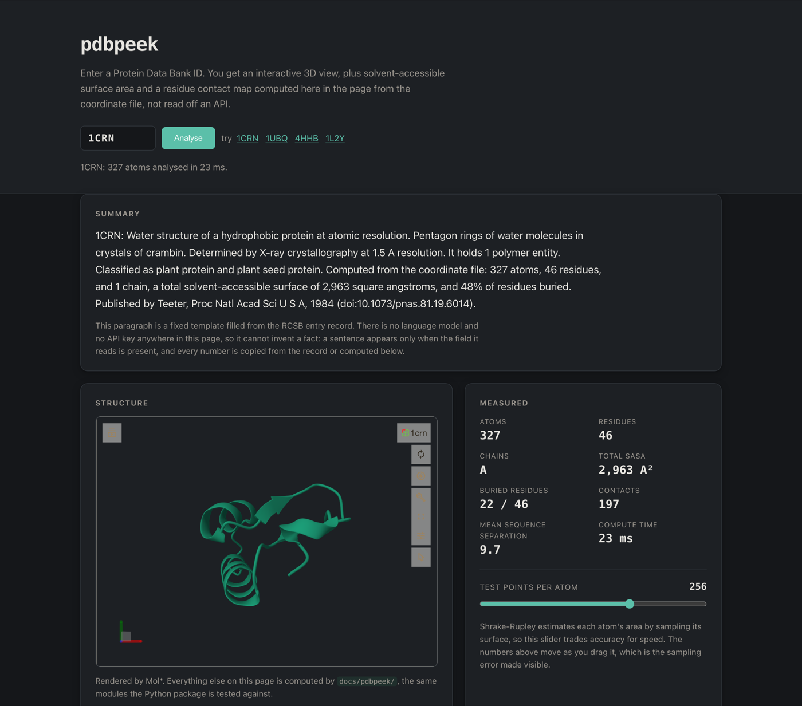
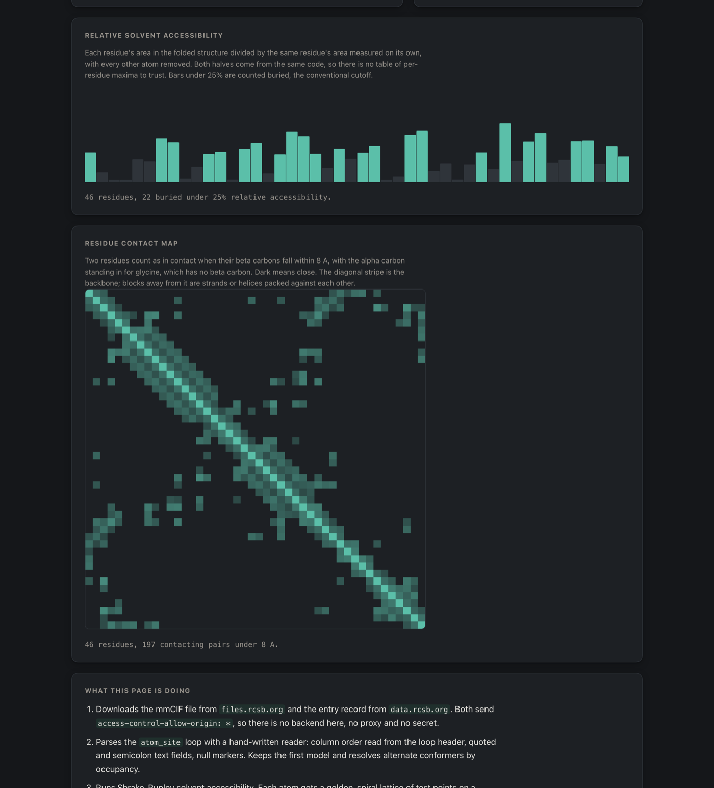

# pdbpeek

[](https://github.com/janeulzhan/pdbpeek/actions/workflows/ci.yml)

Enter a Protein Data Bank ID and get an interactive 3D view alongside real
structural analysis: solvent-accessible surface area, per-residue burial, and
a residue contact map, all computed from the coordinate file rather than read
off an API.

There is a Python package and a browser demo. They implement the same things
twice, in two languages, and a test proves they agree.

## Why this is not an API wrapper

Nothing interesting here is downloaded. The only thing fetched is the mmCIF
file itself and some entry metadata.

**The mmCIF parser is hand-written.** No structure-parsing library. It reads
the subset of the mmCIF/STAR grammar that deposited coordinate files actually
use: `loop_` headers with the column order read from the file rather than
assumed, single-quoted, double-quoted and semicolon-delimited text fields,
`.` and `?` null markers, multiple models, alternate conformers, insertion
codes. Malformed input raises a typed error rather than producing a plausible
wrong answer.

**Shrake-Rupley SASA is implemented from scratch**, and validated against an
independent peer-reviewed implementation to within 0.1% (see
[Validation](#validation)).

**The plain-English summary uses no language model and no API key.** It is a
deterministic template over fields from the RCSB entry record, so it cannot
hallucinate: a sentence appears only when the field it reads is present and
well formed, and every number in it is copied from the record or computed
from the coordinates. The prose is plainer than a model's would be. That is
the trade, and it is the right one for a tool whose output you might paste
into a lab notebook.

**The browser does the same work the Python does.** `tests/test_parity.py`
runs the demo's JavaScript modules under node and compares them against the
Python package atom by atom. On every structure tested the per-atom areas
come out bit-identical.

## Live demo

The demo page is in [`docs/`](docs/) and is served by GitHub Pages at
**https://janeulzhan.github.io/pdbpeek/** once Pages is enabled on the
repository. Until then, run it locally:

```sh
python3 -m http.server 8731 --directory docs
# then open http://127.0.0.1:8731/
```





Both screenshots are real captures of the running page, taken by
[`tools/screenshot.mjs`](tools/screenshot.mjs), which drives headless Chrome
over the DevTools Protocol. That script is macOS-only as written: it hardcodes
the Chrome path at `/Applications/Google Chrome.app`, and uses `sips` for
downscaling. Point `CHROME` at another binary to run it elsewhere.

The page needs no backend and holds no secrets. `files.rcsb.org` and
`data.rcsb.org` both send `access-control-allow-origin: *`, so the browser
talks to them directly. Mol* is pinned to an exact version on jsDelivr and
loaded with a subresource integrity hash, so the browser rejects the file if
the CDN ever serves different bytes.

## Quickstart

Verified from a fresh clone on Python 3.11.9.

```sh
git clone https://github.com/janeulzhan/pdbpeek.git
cd pdbpeek
python3 -m pip install numpy scipy pytest
python3 -m pip install -e .

# Analyse a local file, no network needed
python3 -m pdbpeek tests/fixtures/1CRN.cif --no-summary

# Or fetch an entry and template its summary
python3 -m pdbpeek 1UBQ

# Run the tests
python3 -m pytest
```

Output of the first command:

```
pdbpeek 1CRN

  atoms              327
  residues           46
  chains             1 (A)
  models in file     1
  total SASA         2,962.7 A^2  (probe 1.4 A, 256 points/atom)
  buried residues    22 of 46
  contacts           197 pairs under 8 A, mean sequence separation 9.7

  most exposed residues
    PRO A36      138.7 A^2   rel 0.58
    TYR A29      167.7 A^2   rel 0.51
    LEU A18      142.9 A^2   rel 0.50
    ...
```

`--json` gives the same thing machine-readable, with every residue.

As a library:

```python
from pdbpeek import parse_file, select, compute_sasa, contact_map

structure = select(parse_file("tests/fixtures/1CRN.cif"), drop_hetatm=True)
sasa = compute_sasa(structure, n_points=256)

print(f"{sasa.total:.1f} A^2 over {len(structure.atoms)} atoms")
for key, rel in zip(sasa.residue_keys, sasa.relative_residue_sasa):
    chain, seq, name = key
    print(f"{name} {chain}{seq}  {rel:.2f}")
```

## How the SASA works

Each atom is given an extended radius, its van der Waals radius plus a 1.4 A
probe, which is the radius of a water oxygen. A lattice of test points is
spread over that extended sphere, and a point counts as accessible if it lies
outside every neighbouring atom's extended sphere. The atom's area is then the
full sphere area scaled by the fraction of points that survived:
`4*pi*(r+probe)^2 * accessible/total`. Summing over atoms gives the molecular
surface, and grouping by residue gives the per-residue values.

Two choices differ from the 1973 paper. Test points come from a golden-spiral
(Fibonacci) lattice rather than latitude bands, which has no polar clustering
and so lower variance at a given point count, and which is cheap to reproduce
exactly in another language. Neighbour lists come from a scipy KD-tree in
Python and a uniform cell grid in JavaScript; both are exact queries, not
approximations, so they return the same neighbours the naive all-pairs version
would.

Relative accessibility, the number used to call a residue buried, divides each
residue's area in the folded structure by that same residue's area measured on
its own with every other atom deleted. Both halves come from the same code
path, so there is no published table of per-residue maxima to trust or to get
out of date. The 25% cutoff for "buried" is the conventional one and is a
parameter, not a constant.

## Validation

### Against an independent implementation

Totals are checked against [FreeSASA](https://freesasa.github.io/) 2.2.1, a
peer-reviewed C implementation of the same algorithm. The comparison is made
fair by construction: `freesasa.calcCoord` takes raw coordinates and radii, so
FreeSASA never reads the mmCIF file and never applies its own radius
classifier. Both implementations run Shrake-Rupley on byte-identical geometry
with byte-identical radii, which isolates the algorithm. Any disagreement is
sampling, not input.

At 1000 test points per atom. Note the atom counts are higher here than in
the [Benchmark](#benchmark) table below: this comparison keeps waters and
other HETATM records, because the point is to feed both implementations the
largest possible identical input, while the benchmark drops them to measure
the protein alone. The selection used is recorded in the `selection` field of
`tests/fixtures/sasa_reference.json`.

| entry | atoms | pdbpeek | FreeSASA | relative difference |
| --- | --- | --- | --- | --- |
| 1CRN | 327 | 2970.43 | 2967.62 | 9.5e-04 |
| 1UBQ | 660 | 5732.78 | 5727.63 | 9.0e-04 |
| 2MBW | 1409 | 9143.44 | 9145.84 | 2.6e-04 |
| 4HHB | 4779 | 24090.97 | 24087.41 | 1.5e-04 |

Worst case 9.5e-04. FreeSASA is a development-time dependency only: its output
is committed as `tests/fixtures/sasa_reference.json` by
[`tests/gen_reference.py`](tests/gen_reference.py), so running the test suite
needs nothing but numpy, scipy and pytest.

### Against closed-form geometry

Two cases have exact answers, so these compare the estimate against the truth
rather than against another estimate.

A single isolated atom has SASA `4*pi*(r+probe)^2`. Measured worst relative
error across five radii and five point counts: **1.3e-16**, which is double
precision.

Two overlapping atoms each lose exactly one spherical cap, area `2*pi*R*h`,
so the pair's true area is closed form. Across ten separations from 1.5 to
6.2 A at 4096 points, worst relative error **4.4e-04**:

| separation (A) | pdbpeek | exact | relative error |
| --- | --- | --- | --- |
| 1.5 | 142.762 | 142.731 | 2.2e-04 |
| 3.0 | 170.956 | 170.896 | 3.5e-04 |
| 5.0 | 208.730 | 208.639 | 4.4e-04 |
| 6.2 | 227.909 | 227.909 | 1.2e-16 |

At 6.2 A the spheres have just separated, so the sampled answer is the exact
sum of two whole spheres and the error collapses to rounding.

### Convergence

Sampling error shrinks as the point count rises. 1CRN against its own
20000-point value (2971.25 A^2):

| points per atom | total SASA | relative difference |
| --- | --- | --- |
| 8 | 3041.30 | 2.4e-02 |
| 16 | 2975.98 | 1.6e-03 |
| 64 | 2952.04 | 6.5e-03 |
| 256 | 2962.72 | 2.9e-03 |
| 1024 | 2972.36 | 3.7e-04 |
| 4096 | 2971.87 | 2.1e-04 |

Not monotone, which is what sampling looks like: an individual point count can
land luckily. The trend is what matters, and the test asserts the trend.

### JavaScript against Python

The strongest result in the repository. `tests/test_parity.py` runs
`docs/pdbpeek/*.js` under node, unmodified, and compares them against the
Python package. Across five structures at 64, 256 and 1000 points per atom:

| quantity | agreement |
| --- | --- |
| per-atom SASA | bit-identical, every atom, every structure |
| total SASA | within 3.3e-15 relative |
| atom, residue, chain and contact counts | exact |
| summary text | byte-identical |

The totals differ at all only because of summation order: numpy adds pairwise,
the JavaScript loop adds left to right. The per-atom equality is possible
because both sides build the golden-spiral point set from the same closed form
and both use exact neighbour searches. The test also pins the shared radius
table and the sphere point set directly, since a divergence in either would be
invisible on a protein made of C, N, O and S and then surface as a silent
error on a metal.

## Benchmark

Deterministic values, gated in CI by `tools/benchlock.py`:

| entry | atoms | residues | chains | total SASA (A^2) | contacts |
| --- | --- | --- | --- | --- | --- |
| 1CRN | <!--bench:sasa.1crn.n_atoms-->327<!--/bench--> | <!--bench:sasa.1crn.n_residues-->46<!--/bench--> | <!--bench:sasa.1crn.n_chains-->1<!--/bench--> | <!--bench:sasa.1crn.total_sasa-->2962.7214<!--/bench--> | <!--bench:sasa.1crn.n_contacts-->197<!--/bench--> |
| 1UBQ | <!--bench:sasa.1ubq.n_atoms-->602<!--/bench--> | <!--bench:sasa.1ubq.n_residues-->76<!--/bench--> | <!--bench:sasa.1ubq.n_chains-->1<!--/bench--> | <!--bench:sasa.1ubq.total_sasa-->4871.4971<!--/bench--> | <!--bench:sasa.1ubq.n_contacts-->334<!--/bench--> |
| 2MBW | <!--bench:sasa.2mbw.n_atoms-->1225<!--/bench--> | <!--bench:sasa.2mbw.n_residues-->154<!--/bench--> | <!--bench:sasa.2mbw.n_chains-->1<!--/bench--> | <!--bench:sasa.2mbw.total_sasa-->8220.9401<!--/bench--> | <!--bench:sasa.2mbw.n_contacts-->742<!--/bench--> |
| 4HHB | <!--bench:sasa.4hhb.n_atoms-->4384<!--/bench--> | <!--bench:sasa.4hhb.n_residues-->574<!--/bench--> | <!--bench:sasa.4hhb.n_chains-->4<!--/bench--> | <!--bench:sasa.4hhb.total_sasa-->26111.3534<!--/bench--> | <!--bench:sasa.4hhb.n_contacts-->2968<!--/bench--> |

At 256 test points per atom, first model, highest-occupancy conformer,
hydrogens and waters removed. These numbers depend only on the input and the
algorithm, so they are reproducible anywhere, which is why CI can check them.

Timings, which are **not** gated in CI:

| entry | atoms | mean wall time (s) | stddev (s) | atoms/sec |
| --- | --- | --- | --- | --- |
| 1CRN | 327 | 0.0220 | 0.0002 | 14879 |
| 1UBQ | 602 | 0.0398 | 0.0000 | 15122 |
| 2MBW | 1225 | 0.0868 | 0.0025 | 14119 |
| 4HHB | 4384 | 0.3113 | 0.0028 | 14084 |

Apple M4, 16 GiB, macOS 15.5, Python 3.11.9, numpy 2.4.6. Two warmup runs
discarded, then 10 timed runs. That is about 3.6M atom-point tests per second,
and throughput stays flat from 327 to 4384 atoms, which is the KD-tree doing
its job: without it the work would grow quadratically. Raw rows are in
[`bench/results.csv`](bench/results.csv); regenerate with
`python3 bench/bench_sasa.py --csv bench/results.csv`.

In the browser, 1CRN at 256 points takes about 23 ms, measured in headless
Chrome on the same machine and visible in the screenshot above.

### What the second implementation was good for

Having the same algorithm twice was meant as a correctness check. It turned
into a performance finding, because the JavaScript was an order of magnitude
faster than the numpy version, which is not the usual direction.

`python3 bench/bench_cross_language.py --csv bench/cross_language.csv` runs
all three variants on identical inputs and writes
[`bench/cross_language.csv`](bench/cross_language.csv). Defaults are 2 warmup
runs and 10 timed runs, which is what the table below used; fewer warmup runs
gives V8 no chance to settle and the ratios scatter badly.

| entry | atoms | Python before (s) | Python now (s) | JS (s) | Python speedup | JS vs before | JS vs now |
| --- | --- | --- | --- | --- | --- | --- | --- |
| 1CRN | 327 | 0.0561 | 0.0290 | 0.0057 | 1.93x | 9.9x | 5.1x |
| 1UBQ | 602 | 0.0963 | 0.0514 | 0.0096 | 1.87x | 10.1x | 5.4x |
| 2MBW | 1225 | 0.2339 | 0.1150 | 0.0208 | 2.04x | 11.2x | 5.5x |
| 4HHB | 4384 | 0.7888 | 0.4142 | 0.0744 | 1.90x | 10.6x | 5.6x |

The script asserts all three produce identical totals before reporting any
ratio, so a speed number cannot come from one side doing less work.

The cause was the inner loop issuing one numpy call per (atom, neighbour)
pair. That is 178364 pairs on 4HHB, measured by `neighbour_pair_count` in
[`bench/bench_block_size.py`](bench/bench_block_size.py), and at that count
numpy's per-call dispatch cost swamps the arithmetic. Testing a block of
neighbours per call fixes it, but only if the block stays small: neighbours
are sorted nearest first so the early exit usually fires after two or three
of them, and a large block evaluates all of its neighbours before checking.

`python3 bench/bench_block_size.py --csv bench/block_size.csv` sweeps it and
writes [`bench/block_size.csv`](bench/block_size.csv). On 4HHB, 10 runs each:

| variant | mean (s) | atoms/sec |
| --- | --- | --- |
| per-neighbour loop, the original | 0.7530 | 5822 |
| block of 4 | 0.4378 | 10014 |
| **block of 8, shipping** | **0.3902** | **11235** |
| block of 16 | 0.4495 | 9754 |
| block of 64 | 0.5992 | 7317 |

Block 8 came out fastest on both 1CRN and 4HHB in every run. Blocks of 32 and
up give most of the gain back, and 64 is roughly a wash with not blocking at
all, which is the early exit being thrown away. The first size I guessed was
64, and it was a regression; the sweep is why the constant is 8.

Absolute times on this machine vary by 10% to 30% between runs, so the ratios
are the durable part and the absolute numbers are a snapshot. That is also
why none of this is gated in CI.

The pre-optimisation loop is kept as `sasa_per_neighbour_baseline` in
`bench/bench_block_size.py` so the "before" column stays reproducible rather
than being a number I remember. `tests/test_bench_scripts.py` asserts it
returns bit-identical areas to the shipping implementation, so it cannot
quietly become a strawman, and asserts that every block size produces the
same answer. The optimisation changed no arithmetic, so the per-atom areas
are still bit for bit what they were, which the parity test confirms.

Wall-clock numbers are machine dependent, so CI never asserts them. A shared
runner's timings would mean nothing, and a timing-based gate that fails at
random teaches everyone to ignore the build.

## Keeping the README honest

Every measured number in the benchmark table above lives inside a marker span:

```
<!--bench:sasa.1crn.total_sasa-->2962.7214<!--/bench-->
```

[`tools/benchlock.py`](tools/benchlock.py) recomputes them and either rewrites
the spans or fails:

```sh
python3 tools/benchlock.py --list    # what can be locked
python3 tools/benchlock.py --check   # CI mode, non-zero exit on drift
python3 tools/benchlock.py --write   # update the README in place
```

CI runs `--check`, so a change that moves a SASA total cannot land while the
README still claims the old one. Integer counts are gated exactly; SASA totals
get a 0.1% tolerance, enough to absorb a different platform's libm rounding a
sine differently, far too tight to hide a real change. Keys containing
`seconds`, `per_second`, `time`, `elapsed`, `wall`, `duration` or `throughput`
are refused outright, so a timing cannot become a CI gate by accident.
`tests/test_benchlock.py` covers the drifted, in-tolerance and
malformed-marker cases.

## Repository layout

```
pdbpeek/            the Python package
  mmcif.py          hand-written mmCIF atom_site reader
  sasa.py           Shrake-Rupley, golden-spiral sampling, analytic references
  contacts.py       CB-CB contact map, CA for glycine
  summary.py        deterministic summary template, no model
  radii.py          Bondi van der Waals radii
  fetch.py          curl-backed downloads, cached
  cli.py            python -m pdbpeek
docs/               the demo, served by GitHub Pages
  index.html        the page
  app.js            fetch, render, wire up
  pdbpeek/*.js      the JavaScript twins, run by the parity test
tests/              296 offline tests, plus 6 network and 3 slow marked
bench/              harnesses and their committed raw CSVs
  bench_sasa.py     the main throughput benchmark
  bench_block_size.py   the neighbour block sweep, and the old inner loop
  bench_cross_language.py   JavaScript against Python on identical input
tools/              benchlock, screenshot, reference and table generators
```

## Limitations

Worth knowing before trusting a number out of this.

- **SASA is sampling-based and therefore approximate.** At the 256-point
  default, expect error on the order of 0.3% of the total. Raise `--n-points`
  if you need tighter. An analytic method such as Lee-Richards with fine
  slicing, or a true analytic surface, would be exact.
- **Hydrogens are dropped by default.** This computes the heavy-atom surface,
  which is the usual convention, but it is a convention and not the whole
  molecule. Deposited X-ray structures rarely have hydrogens anyway.
- **No symmetry mates and no biological assembly.** Only the asymmetric unit
  in the file is used. For a crystal contact or an oligomer that is generated
  by symmetry, the surface reported here will be larger than the biologically
  real one.
- **One model at a time.** NMR depositions have many; this takes the first
  unless told otherwise, and does not average over the ensemble.
- **Alternate conformers are resolved, not modelled.** The highest-occupancy
  conformer wins, so a genuinely bimodal side chain is reported as one state.
- **Radii for metals are not Bondi's**, because Bondi did not cover metals.
  Those entries are ionic and metallic radii in common use, and anything
  absent from the table falls back to 1.8 A. `SasaResult.unknown_elements`
  reports which elements took the fallback, so the approximation is visible
  rather than silent.
- **The contact map needs a CB or a CA.** Waters, ions and most ligands have
  neither, so they are excluded and listed in `ContactMap.skipped`. They still
  contribute to SASA if you keep them with `--keep-waters`.
- **The summary can only be as good as the deposited metadata.** It will not
  invent a missing field, but it also will not notice a wrong one.
- **The demo depends on three third parties being reachable.** RCSB for the
  coordinates and the entry record, with its CORS headers staying permissive,
  and jsDelivr for Mol*. There is no backend to proxy around an outage, and no
  vendored copy of Mol*. The jsDelivr assets are pinned to an exact version
  and carry subresource integrity hashes, so a compromised CDN cannot inject
  code, but it can still take the 3D view offline. The analysis, which is the
  part this repository actually implements, keeps working without it.

## References

- A. Shrake and J. A. Rupley, "Environment and exposure to solvent of protein
  atoms. Lysozyme and insulin", *J. Mol. Biol.* 79:351-371 (1973). The
  algorithm.
- A. Bondi, "van der Waals Volumes and Radii", *J. Phys. Chem.* 68:441-451
  (1964). The radii.
- S. Mitternacht, "FreeSASA: An open source C library for solvent accessible
  surface area calculations", *F1000Research* 5:189 (2016). The reference
  implementation validated against.
- B. Rost and C. Sander, *J. Mol. Biol.* 232:584-599 (1993). The 25% relative
  accessibility convention for calling a residue buried.
- Structure data from the [RCSB Protein Data Bank](https://www.rcsb.org/).
  3D rendering by [Mol*](https://molstar.org/).

## License

MIT. See [LICENSE](LICENSE).
